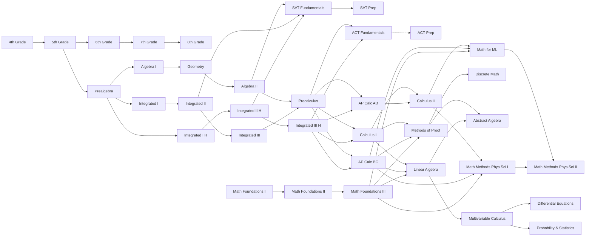

# Math Curriculum: Math Academy Course Catalog

> Source: <https://www.mathacademy.com/courses> and all 37 linked course pages under `/courses/<slug>`, retrieved 2026-10-30.
> Companion: [math-curriculum.zh-CN.md](math-curriculum.zh-CN.md) (中文).
> Full per-course content (description, overview, outcomes, and every unit → module → topic) is in [math-courses/](math-courses/). Machine-readable data for all courses is in [math-courses/math-academy-courses.json](math-courses/math-academy-courses.json).
> Related: [the-math-academy-way.md](the-math-academy-way.md), [math-academy-website.md](math-academy-website.md).

This document records Math Academy's complete math course system as the reference for building Great Academy's math content. The catalog runs from 4th grade arithmetic to upper-division undergraduate mathematics.

## TL;DR

- **37 courses** in 8 groups: elementary (2), middle school (4), high school in three sequences (10), test prep (4), AP (2), Mathematical Foundations for adults (3), and university (12). Two of them are marked "Coming soon" on the catalog page: ACT Math Prep and Abstract Algebra. Abstract Algebra's page already lists its full content and says it is under construction.
- **9,270 topic slots** across all courses, but only **3,535 distinct topic names**. Courses are *views over one shared knowledge graph*, not separate content silos. A topic like "The Law of Total Probability" appears in 9 courses.
- **Content hierarchy is uniform:** Course → Unit (e.g. "2. Matrices", with a topic count) → Module (e.g. "2.4. Gaussian Elimination") → Topic (e.g. "2.4.3. …"). Typical courses have 130–360 topics; test-prep "Fundamentals" courses are much larger (SAT 651, ACT 905) because they aggregate everything an exam can touch.
- **Course sizes cluster:** a standard school-year or semester course is ~130–230 topics; an "honors" or compressed course is ~280–360 topics.
- **Sequences share content almost exactly:**
  - The traditional sequence (Algebra I + Geometry + Algebra II) and the integrated sequence (Integrated Math I–III) have 582 and 588 distinct topics. The only differences are 6 statistics topics that appear only in the integrated sequence.
  - The honors integrated sequence (I–III Honors) has *exactly* the same 838 topics as Algebra I + Geometry + Algebra II + Precalculus.
  - AP Calculus AB is a strict subset of AP Calculus BC. BC ≈ Calculus I + II, minus hyperbolic functions and a few advanced items, plus graphing-calculator topics.
  - Mathematical Foundations I–III contain no topics of their own: every one of their 1,038 topics also appears in a K-12 course or a university calculus course.
- **Content is unique only in a few places:** 4th grade, discrete math, methods of proof, abstract algebra, probability & statistics, and the exam-style prep courses (SAT Math Prep and ACT Math Prep use their own practice-problem topics). Everything else reuses shared topics.

## 1. Catalog-level facts (from /courses)

- "All of our courses are comprehensive and standards-based, typically covering hundreds of individual topics."
- Every course starts with an adaptive diagnostic that identifies missing prerequisite knowledge and material the student already knows.
- **Accreditation:** The courses are fully accredited by ACS WASC (Accrediting Commission for Schools, Western Association of Schools and Colleges).
- **UC a-g:** Math Academy, LLC is listed in UC's Directory of Online Publishers. A home school can add the courses through its UC course-management portal, so that Math Academy can issue transcripts for UC a-g credit.
- **Entry point:** The lowest course is 4th Grade Math. It requires knowing the multiplication tables up to 12 and being able to read independently.
- **Prealgebra vs. 6th–8th:** Prealgebra covers the same content as the 6th–8th grade courses in a streamlined format, for students who can move faster.
- **High-school sequences:**
  - Traditional and integrated cover the same material in a different order.
  - The catalog says the traditional sequence's weakness, relearning Algebra I skills after a year of Geometry, is mitigated by spaced repetition.
  - The honors integrated sequence covers four years of math, including Precalculus, in three.
  - The standard integrated sequence ends at the Algebra II level and feeds into Precalculus.
- **Test prep:** Prep courses (SAT/ACT Math Prep) cannot be joined directly. Students are promoted into them after finishing the corresponding Fundamentals course.
- **AP:** AP Calculus BC represents the two-semester university Calculus I + II. AB covers about 70% of that material.
- **Mathematical Foundations:** For adults heading to advanced university courses who lack foundations. It is "the fastest and most efficient way to get up to speed".
- **University courses:** "Modeled after the rigorous, semester-length courses offered at elite universities, and in many cases, go a few steps beyond."

## 2. Course map and prerequisites

Notes:
- The catalog page lists ACT Math Prep's prerequisite as "SAT Math Fundamentals". That looks like a copy error: the course text says students are promoted from ACT Math Fundamentals.
- Grade 8 has no listed successor on the catalog. Algebra I lists Prealgebra as its prerequisite, which effectively makes Prealgebra and 6th–8th Grade alternative routes into high school.

## 3. Summary table

| # | Course | Group | Prerequisite(s) | Units | Modules | Topics |
|---|---|---|---|---|---|---|
| 1 | [4th Grade Math](math-courses/4th-grade-math.md) | Elementary School | Mastery of multiplication tables up to the 12s | 7 | 22 | 140 |
| 2 | [5th Grade Math](math-courses/5th-grade-math.md) | Elementary School | 4th Grade Math | 9 | 19 | 133 |
| 3 | [6th Grade Math](math-courses/6th-grade-math.md) | Middle School | 5th Grade Math | 8 | 28 | 157 |
| 4 | [7th Grade Math](math-courses/7th-grade-math.md) | Middle School | 6th Grade Math | 5 | 27 | 170 |
| 5 | [8th Grade Math](math-courses/8th-grade-math.md) | Middle School | 7th Grade Math | 9 | 27 | 132 |
| 6 | [Prealgebra](math-courses/prealgebra.md) | Middle School | 5th Grade Math | 7 | 30 | 210 |
| 7 | [Algebra I](math-courses/algebra-i.md) | High School — Traditional | Prealgebra | 12 | 28 | 225 |
| 8 | [Geometry](math-courses/geometry.md) | High School — Traditional | Algebra I | 6 | 19 | 179 |
| 9 | [Algebra II](math-courses/algebra-ii.md) | High School — Traditional | Geometry | 9 | 29 | 179 |
| 10 | [Precalculus](math-courses/precalculus.md) | High School — Traditional / Integrated | Algebra II or Integrated Math III | 12 | 43 | 296 |
| 11 | [Integrated Math I](math-courses/integrated-math-i.md) | High School — Integrated | Prealgebra | 9 | 24 | 199 |
| 12 | [Integrated Math II](math-courses/integrated-math-ii.md) | High School — Integrated | Integrated Math I | 6 | 23 | 213 |
| 13 | [Integrated Math III](math-courses/integrated-math-iii.md) | High School — Integrated | Integrated Math II | 8 | 28 | 176 |
| 14 | [Integrated Math I (Honors)](math-courses/integrated-math-i-honors.md) | High School — Integrated (Honors) | Prealgebra | 11 | 29 | 226 |
| 15 | [Integrated Math II (Honors)](math-courses/integrated-math-ii-honors.md) | High School — Integrated (Honors) | Integrated Math I (Honors) | 12 | 45 | 335 |
| 16 | [Integrated Math III (Honors)](math-courses/integrated-math-iii-honors.md) | High School — Integrated (Honors) | Integrated Math II (Honors) | 15 | 42 | 278 |
| 17 | [SAT Math Fundamentals](math-courses/sat-math-fundamentals.md) | Test Prep | Algebra II, Integrated Math II, or Integrated Math II (Honors) | 17 | 68 | 651 |
| 18 | [SAT Math Prep](math-courses/sat-math-prep.md) | Test Prep | SAT Math Fundamentals (promotion only) | 4 | 45 | 284 |
| 19 | [ACT Math Fundamentals](math-courses/act-math-fundamentals.md) | Test Prep | Precalculus or Integrated Math III (Honors) | 7 | 98 | 905 |
| 20 | [ACT Math Prep](math-courses/act-math-prep.md) | Test Prep (listed as "Coming soon") | SAT Math Fundamentals (as printed; promotion from ACT Math Fundamentals) | 6 | 39 | 348 |
| 21 | [AP Calculus AB](math-courses/ap-calculus-ab.md) | AP | Precalculus or Integrated Math III (Honors) | 9 | 36 | 212 |
| 22 | [AP Calculus BC](math-courses/ap-calculus-bc.md) | AP | Precalculus or Integrated Math III (Honors) | 16 | 53 | 305 |
| 23 | [Mathematical Foundations I](math-courses/mathematical-foundations-i.md) | Mathematical Foundations (adults) | — | 13 | 45 | 357 |
| 24 | [Mathematical Foundations II](math-courses/mathematical-foundations-ii.md) | Mathematical Foundations (adults) | Mathematical Foundations I | 14 | 52 | 360 |
| 25 | [Mathematical Foundations III](math-courses/mathematical-foundations-iii.md) | Mathematical Foundations (adults) | Mathematical Foundations II | 15 | 53 | 323 |
| 26 | [Calculus I](math-courses/calculus-i.md) | University | Precalculus or Integrated Math III (Honors) | 8 | 27 | 175 |
| 27 | [Calculus II](math-courses/calculus-ii.md) | University | Calculus I or AP Calculus AB | 5 | 29 | 160 |
| 28 | [Linear Algebra](math-courses/linear-algebra.md) | University | Calculus I, AP Calculus BC, or Mathematical Foundations III | 8 | 31 | 181 |
| 29 | [Multivariable Calculus](math-courses/multivariable-calculus.md) | University | Linear Algebra | 6 | 29 | 187 |
| 30 | [Methods of Proof](math-courses/methods-of-proof.md) | University | Calculus I, AP Calculus BC, or Mathematical Foundations III | 7 | 20 | 135 |
| 31 | [Differential Equations](math-courses/differential-equations.md) | University | Multivariable Calculus | 7 | 26 | 159 |
| 32 | [Discrete Mathematics](math-courses/discrete-mathematics.md) | University | Methods of Proof | 8 | 33 | 143 |
| 33 | [Probability & Statistics](math-courses/probability-and-statistics.md) | University | Multivariable Calculus | 10 | 33 | 181 |
| 34 | [Mathematics for Machine Learning](math-courses/mathematics-for-machine-learning.md) | University | Calculus II, AP Calculus BC, or Mathematical Foundations III | 12 | 47 | 301 |
| 35 | [Mathematical Methods for the Physical Sciences I](math-courses/mathematical-methods-for-the-physical-sciences-i.md) | University | Calculus II, AP Calculus BC, or Mathematical Foundations III | 13 | 46 | 294 |
| 36 | [Mathematical Methods for the Physical Sciences II](math-courses/mathematical-methods-for-the-physical-sciences-ii.md) | University | Mathematical Methods for the Physical Sciences I | 12 | 40 | 232 |
| 37 | [Abstract Algebra](math-courses/abstract-algebra.md) | University (listed as "Coming soon") | Methods of Proof; Linear Algebra | 9 | 21 | 129 |

Totals: 37 courses · 351 units · 1,334 modules · 9,270 topic slots · 3,535 distinct topic names.

## 4. Structure and reuse analysis

These figures come from comparing topic names across the 37 course pages.

**How widely topics are shared:**

| Courses a topic appears in | 1 | 2 | 3 | 4 | 5 | 6+ |
|---|---|---|---|---|---|---|
| Distinct topics | 1,434 | 577 | 493 | 396 | 286 | 349 |

**Where a course's topics also appear (containment):**

| Course | Its topics also found in |
|---|---|
| 7th Grade Math | SAT Fundamentals 82%, ACT Fundamentals 66%, Prealgebra 61% |
| Prealgebra | SAT Fundamentals 91%, Math Foundations I 81%, ACT Fundamentals 80% |
| Algebra I | ACT Fundamentals 92%, SAT Fundamentals 85%, Integrated I (H) 73% |
| Algebra II | Math Foundations II 84%, Integrated II (H) 78% |
| Integrated III (H) | Precalculus 85% |
| AP Calculus AB | AP Calculus BC 100%, Calculus I 72% |
| Calculus I | AP Calculus BC 89% |
| Calculus II | AP Calculus BC 88% |
| Linear Algebra | Math Methods Phys Sci I 65%, Math for ML 64% |
| Multivariable Calculus | Math Methods Phys Sci I 48%, Math Methods Phys Sci II 48% |
| Differential Equations | Math Methods Phys Sci I 48%, Math Methods Phys Sci II 36% |
| Probability & Statistics | Math for ML 52% |
| Math Foundations III | Precalculus 51%, Integrated III (H) 47%, AP Calculus BC 44% |

**Set identities found:**
- Algebra I ∪ Geometry ∪ Algebra II (582 topics) vs. Integrated I ∪ II ∪ III (588 topics): identical apart from 6 integrated-only statistics topics: Sampling, Variance and Standard Deviation, Sigma Notation, The Mean of a Data Set, Residuals and Residual Plots, and Correlation vs. Causation.
- Integrated I–III (Honors) = Algebra I ∪ Geometry ∪ Algebra II ∪ Precalculus, exactly (838 topics).
- AP Calculus AB ⊂ AP Calculus BC.
- AP Calculus BC has 9 topics outside Calculus I ∪ II. All of them are graphing-calculator or technology topics (the AP exam's technology section).
- Calculus I ∪ II has 39 topics outside BC, such as:
  - hyperbolic functions and their derivatives and integrals,
  - logarithmic differentiation,
  - Newton's method,
  - surface areas of revolution,
  - the shell method rotated about the x-axis,
  - the root test,
  - Newton's second law.
- Mathematical Foundations I ∪ II ∪ III (1,038 topics) is drawn entirely from K-12 and calculus courses. It has 0 topics of its own.
- Math Methods for the Physical Sciences I ∪ II is drawn from Linear Algebra, Multivariable Calculus, Differential Equations, Probability & Statistics and Math for ML, with only 1 exception.
- Prealgebra has only 8 topics outside the 5th–8th grade courses. 6th–8th Grade cover 218 topics that are in neither Prealgebra nor Algebra I. The grade courses are broader and more standards-aligned (CCSS domains such as "Ratios & Proportional Relationships", "The Number System" and "Expressions & Equations"). Prealgebra is the streamlined core.
- **Test prep:**
  - SAT Math Fundamentals (651) and ACT Math Fundamentals (905) are mostly aggregations of school-course topics; 89% of SAT Fundamentals is inside ACT Fundamentals.
  - SAT Math Prep (284) and ACT Math Prep (348) are almost entirely their own topics: "high-fidelity SAT-style problems".
  - SAT Math Prep routes struggling students back to the corresponding Fundamentals topic for instruction.
  - SAT Math Prep has no fixed endpoint and shows a continuously updated estimated SAT score.

**Implication:** Math Academy maintains one knowledge graph of roughly 3,500 topics. A "course" is a curated, ordered subset of topics, grouped into units and modules for display. This matches the book's description, where a course is a set of topics in the shared graph and the diagnostic and task selection operate on the graph rather than on the course.

## 5. Course details

Units are listed with their topic counts. The full module and topic list for each course is in the linked file.

### Elementary School

#### 4th Grade Math

Our fully accredited, Common Core-aligned 4th Grade Math course draws on students' knowledge of basic arithmetic to develop concrete models on which to base higher-level arithmetic techniques. Once a thorough understanding of these concrete models is established, students use them to obtain computational fluency in the four fundamental arithmetic operations. Students gain a solid grasp of other types of numbers (fractions and decimals), including mastering some operations with these objects. Finally, students further develop their reasoning and modeling skills, including applying them to real-world situations involving data, geometry, and units.

- **Prerequisite(s):** Mastery of multiplication tables up to the 12s
- **Size:** 7 units · 22 modules · 140 topics
- **Full content:** [math-courses/4th-grade-math.md](math-courses/4th-grade-math.md) · [source](https://www.mathacademy.com/courses/4th-grade-math)
- **Units:** 1. Operations & Algebraic Thinking (9); 2. The Number System (15); 3. Addition & Subtraction (13); 4. Multiplication (20); 5. Division (16); 6. Fractions & Decimals (45); 7. Measurement & Data (22)

#### 5th Grade Math

Our fully accredited 5th Grade Math course, aligned with the Common Core standards, is expertly designed to build upon the robust foundations laid down in our 4th Grade course. This comprehensive course empowers students to master the standard algorithms for multiplication, division, and arithmetic involving fractions and decimals. Beyond computations, students will delve deeper into vital mathematical concepts, including numerical expressions, negative numbers, units of measurement, exponents, number patterns, and geometry. Finally, the course requires students to apply their knowledge across varying contexts, fostering a holistic understanding of mathematics and its practical applications.

- **Prerequisite(s):** 4th Grade Math
- **Size:** 9 units · 19 modules · 133 topics
- **Full content:** [math-courses/5th-grade-math.md](math-courses/5th-grade-math.md) · [source](https://www.mathacademy.com/courses/5th-grade-math)
- **Units:** 1. The Number System (9); 2. Multiplying & Dividing Whole Numbers (18); 3. Adding & Subtracting Fractions (14); 4. Multiplying & Dividing Fractions (26); 5. Decimals (18); 6. Multiplying & Dividing Decimals (17); 7. Exponents (10); 8. Measurement & Data (12); 9. Geometry (9)

### Middle School

#### 6th Grade Math

This Common Core-aligned 6th Grade Math course builds on the foundations established in the 5th Grade course and expands students’ understanding of number, operations, algebraic thinking, geometry, and data analysis. Students deepen their fluency with ratios, rates, percentages, multi-digit division, fraction division, decimals, rational numbers, expressions, equations, geometry, and statistics.

- **Prerequisite(s):** 5th Grade Math
- **Size:** 8 units · 28 modules · 157 topics
- **Full content:** [math-courses/6th-grade-math.md](math-courses/6th-grade-math.md) · [source](https://www.mathacademy.com/courses/6th-grade-math)
- **Units:** 1. Ratios & Proportional Relationships (28); 2. The Number System: Whole Number Division (11); 3. The Number System: Dividing Fractions (17); 4. The Number System: Decimals (16); 5. The Number System: Rational Numbers (20); 6. Expressions & Equations (27); 7. Geometry (20); 8. Statistics & Probability (18)

#### 7th Grade Math

Our fully accredited, Common Core-aligned 7th Grade Math course builds on students' earlier work in arithmetic and measurement to develop fluency with proportional reasoning, rational numbers, algebraic thinking, geometry, and data analysis. Students extend their understanding of number to include signed rational numbers, percent change, and exponent notation, and they learn to represent and solve increasingly sophisticated equations and inequalities. Throughout the course, students apply mathematics in real-world contexts involving finance, scale, geometry, sampling, and probability. By combining conceptual understanding, procedural fluency, and modeling, this course prepares students for more advanced study in algebra and geometry.

- **Prerequisite(s):** 6th Grade Math
- **Size:** 5 units · 27 modules · 170 topics
- **Full content:** [math-courses/7th-grade-math.md](math-courses/7th-grade-math.md) · [source](https://www.mathacademy.com/courses/7th-grade-math)
- **Units:** 1. Ratios & Proportional Relationships (22); 2. The Number System (28); 3. Expressions & Equations (45); 4. Geometry (45); 5. Statistics & Probability (30)

#### 8th Grade Math

Our 8th Grade Math course is Common Core aligned and develops students’ fluency, reasoning, and problem-solving skills across the real number system, exponents, scientific notation, radicals, number theory, linear equations, functions, transformations, congruence, similarity, the Pythagorean theorem, volume, and bivariate statistics. This course emphasizes conceptual understanding, algebraic reasoning, divisibility and number structure, multiple representations, geometric reasoning, mathematical modeling, and clear interpretation of quantitative relationships.

- **Prerequisite(s):** 7th Grade Math
- **Size:** 9 units · 27 modules · 132 topics
- **Full content:** [math-courses/8th-grade-math.md](math-courses/8th-grade-math.md) · [source](https://www.mathacademy.com/courses/8th-grade-math)
- **Units:** 1. The Real Number System (6); 2. Exponents & Scientific Notation (22); 3. Radicals (16); 4. Number Theory (8); 5. Linear Equations (21); 6. Functions (10); 7. Geometry: Transformations, Congruence, & Similarity (29); 8. The Pythagorean Theorem & Volume (11); 9. Statistics: Bivariate Data (9)

#### Prealgebra

Our fully accredited Prealgebra course serves as an accelerated bridge between 5th Grade Math and our high-school math curriculum, covering many key middle-school Common Core standards while preparing students to move efficiently toward High-School Algebra.

- **Prerequisite(s):** 5th Grade Math
- **Size:** 7 units · 30 modules · 210 topics
- **Full content:** [math-courses/prealgebra.md](math-courses/prealgebra.md) · [source](https://www.mathacademy.com/courses/prealgebra)
- **Units:** 1. Ratios & Percentages (30); 2. The Number System (29); 3. Exponents & Radicals (35); 4. Algebraic Expressions (17); 5. Equations & Inequalities (29); 6. Geometry (48); 7. Statistics (22)

### High School

#### Algebra I

Algebra I is a fully accredited, Common Core-aligned course that builds on the foundations developed in Prealgebra. Upon completing the course, students will create a solid base for success in subsequent courses such as Geometry, Algebra II, and beyond.

- **Prerequisite(s):** Prealgebra
- **Size:** 12 units · 28 modules · 225 topics
- **Full content:** [math-courses/algebra-i.md](math-courses/algebra-i.md) · [source](https://www.mathacademy.com/courses/algebra-i)
- **Units:** 1. Equations & Inequalities (25); 2. Two-Variable Equations & Inequalities (33); 3. Units (13); 4. Radical Expressions (12); 5. Rational Expressions & Equations (7); 6. Functions (18); 7. Absolute Value (14); 8. Exponential Functions (22); 9. Polynomials (20); 10. Quadratic Equations & Functions (37); 11. Sequences (18); 12. Bivariate Statistics (6)

#### Geometry

This fully accredited, Common Core-aligned Geometry course provides a comprehensive treatment of high-school geometry. Students will deep-dive into geometric transformations, congruence, similarity, mathematical proof, circles, radians, coordinate geometry, elementary trigonometry, solid geometry, probability, and combinatorics. This course lays the foundations for progression onto Algebra II , where more advanced geometrical and trigonometric concepts are encountered.

- **Prerequisite(s):** Algebra I
- **Size:** 6 units · 19 modules · 179 topics
- **Full content:** [math-courses/geometry.md](math-courses/geometry.md) · [source](https://www.mathacademy.com/courses/geometry)
- **Units:** 1. Proof, Congruence, & Similarity (42); 2. Circles & Radian Measure (28); 3. Geometry in the Coordinate Plane (22); 4. Triangles, Quadrilaterals, & Trigonometry (27); 5. Solid Geometry (26); 6. Probability & Combinatorics (34)

#### Algebra II

Our comprehensive, fully accredited, Common Core-aligned Algebra II course is designed to build upon the strong foundations acquired in Algebra I and Geometry, delving deeper into algebra, functions, geometry, and trigonometry. This course will further develop students' mathematical understanding and problem-solving skills, preparing them for success in our Precalculus course, the final stepping stone before calculus.

- **Prerequisite(s):** Geometry
- **Size:** 9 units · 29 modules · 179 topics
- **Full content:** [math-courses/algebra-ii.md](math-courses/algebra-ii.md) · [source](https://www.mathacademy.com/courses/algebra-ii)
- **Units:** 1. Number Systems (10); 2. Polynomials (30); 3. Functions (26); 4. Exponentials & Logarithms (35); 5. Rational Expressions & Functions (12); 6. Radical Expressions & Functions (11); 7. Conic Sections (9); 8. The Unit Circle (21); 9. Trigonometric Functions (25)

#### Precalculus

Our fully accredited Common-Core aligned Precalculus course builds upon the strong foundations formed in Algebra II, further developing students' knowledge and skills in algebra, geometry, and trigonometry. In addition, students begin their journey into higher-level probability and statistics and explore new mathematical objects, namely vectors, matrices, and random variables. Upon completing this course, students will have gained all the necessary tools to study calculus and other foundational college-level courses successfully.

- **Prerequisite(s):** Algebra II or Integrated Math III
- **Size:** 12 units · 43 modules · 296 topics
- **Full content:** [math-courses/precalculus.md](math-courses/precalculus.md) · [source](https://www.mathacademy.com/courses/precalculus)
- **Units:** 1. Sequences and Series (18); 2. Rational Functions (16); 3. Inequalities (21); 4. Trigonometry (42); 5. Vectors (30); 6. Matrices (37); 7. Conic Sections (20); 8. Parametric Equations (10); 9. Polar Equations (6); 10. Complex Numbers (28); 11. Probability & Combinatorics (48); 12. Statistics (20)

#### Integrated Math I

Integrated Math I is a fully accredited, Common Core-aligned course that builds on the foundations developed in Prealgebra .

- **Prerequisite(s):** Prealgebra
- **Size:** 9 units · 24 modules · 199 topics
- **Full content:** [math-courses/integrated-math-i.md](math-courses/integrated-math-i.md) · [source](https://www.mathacademy.com/courses/integrated-math-i)
- **Units:** 1. Equations & Inequalities (25); 2. Two-Variable Equations & Inequalities (32); 3. Units (13); 4. Rationals & Radicals (17); 5. Functions (14); 6. Absolute Value (14); 7. Exponents (21); 8. Polynomials (20); 9. Geometry (43)

#### Integrated Math II

Our comprehensive, fully accredited, Common Core-aligned Integrated Math II course builds upon the strong foundations acquired in Integrated Math I, delving deeper into algebra, functions, geometry, trigonometry, probability, and statistics. This course will further develop students' mathematical understanding and problem-solving skills, preparing them for success in our Integrated Math III course, the final stepping stone before Precalculus

- **Prerequisite(s):** Integrated Math I
- **Size:** 6 units · 23 modules · 213 topics
- **Full content:** [math-courses/integrated-math-ii.md](math-courses/integrated-math-ii.md) · [source](https://www.mathacademy.com/courses/integrated-math-ii)
- **Units:** 1. Quadratics (38); 2. Functions & Sequences (32); 3. Exponentials & Logarithms (17); 4. Geometry (70); 5. Trigonometry (32); 6. Probability & Statistics (24)

#### Integrated Math III

Our fully accredited Common Core-aligned Integrated Math III course builds upon the strong foundations formed in Integrated Math I and Integrated Math II , further developing students' knowledge and skills in polynomials, rationals, radicals, exponentials, logarithms, number systems, geometry, trigonometry, and probability. Upon completing this course, students will attain the knowledge and skills needed to study Precalculus .

- **Prerequisite(s):** Integrated Math II
- **Size:** 8 units · 28 modules · 176 topics
- **Full content:** [math-courses/integrated-math-iii.md](math-courses/integrated-math-iii.md) · [source](https://www.mathacademy.com/courses/integrated-math-iii)
- **Units:** 1. Polynomials (30); 2. Rationals and Radicals (25); 3. Exponentials & Logarithms (18); 4. Number Systems (10); 5. Sequences (15); 6. Geometry (25); 7. Trigonometry (31); 8. Probability & Statistics (22)

#### Integrated Math I (Honors)

Integrated Math I (Honors) is a fully accredited, Common Core-aligned course that builds on the foundations developed in Prealgebra .

- **Prerequisite(s):** Prealgebra
- **Size:** 11 units · 29 modules · 226 topics
- **Full content:** [math-courses/integrated-math-i-honors.md](math-courses/integrated-math-i-honors.md) · [source](https://www.mathacademy.com/courses/integrated-math-i-honors)
- **Units:** 1. Equations & Inequalities (25); 2. Two-Variable Equations & Inequalities (32); 3. Units (13); 4. Radicals and Rationals (17); 5. Functions (14); 6. Absolute Value (6); 7. Exponents (21); 8. Polynomials (20); 9. Sequences (12); 10. Geometry (60); 11. Statistics (6)

#### Integrated Math II (Honors)

Our comprehensive, fully accredited, Common Core-aligned Integrated Math II (Honors) course builds upon the strong foundations acquired in Integrated Math I, delving deeper into algebra, functions, geometry, trigonometry, probability, and statistics. This course will further develop students' mathematical understanding and problem-solving skills, preparing them for success in our Integrated Math III (Honors) course, the final stepping stone before Calculus.

- **Prerequisite(s):** Integrated Math I (Honors)
- **Size:** 12 units · 45 modules · 335 topics
- **Full content:** [math-courses/integrated-math-ii-honors.md](math-courses/integrated-math-ii-honors.md) · [source](https://www.mathacademy.com/courses/integrated-math-ii-honors)
- **Units:** 1. Number Systems (10); 2. Polynomials (31); 3. Quadratic Functions (18); 4. Functions (30); 5. Absolute Value Functions (8); 6. Exponentials & Logarithms (35); 7. Sequences & Series (17); 8. Rationals & Radicals (7); 9. Geometry (53); 10. Solid Geometry (26); 11. Trigonometry (57); 12. Probability & Statistics (43)

#### Integrated Math III (Honors)

Our fully accredited Common Core-aligned Integrated Math III course builds upon the strong foundations formed in Integrated Math I and Integrated Math II , further developing students' knowledge and skills in algebra, geometry, trigonometry, probability, and statistics. In addition, this course introduces new mathematical objects, namely vectors, matrices, and random variables. Upon completing this course, students will have gained all the necessary tools to study calculus and other foundational college-level courses successfully.

- **Prerequisite(s):** Integrated Math II (Honors)
- **Size:** 15 units · 42 modules · 278 topics
- **Full content:** [math-courses/integrated-math-iii-honors.md](math-courses/integrated-math-iii-honors.md) · [source](https://www.mathacademy.com/courses/integrated-math-iii-honors)
- **Units:** 1. Sequences & Series (7); 2. Polynomials (19); 3. Rational Equations & Functions (21); 4. Radical Functions (13); 5. Inequalities (21); 6. Conics (20); 7. Trigonometric Functions (10); 8. Trigonometric Identities (22); 9. Trigonometric Equations (15); 10. Parametric Equations (10); 11. Polar Equations (6); 12. Complex Numbers (28); 13. Vectors (30); 14. Matrices (37); 15. Probability and Statistics (19)

### Test Prep

#### SAT Math Fundamentals

Our SAT Math Fundamentals course develops the complete mathematical foundation required to excel on the math section of the SAT exam, spanning every tested topic from Prealgebra through Algebra II and Trigonometry.

- **Prerequisite(s):** Algebra II, Integrated Math II, or Integrated Math II (Honors)
- **Size:** 17 units · 68 modules · 651 topics
- **Full content:** [math-courses/sat-math-fundamentals.md](math-courses/sat-math-fundamentals.md) · [source](https://www.mathacademy.com/courses/sat-math-fundamentals)
- **Units:** 1. Preliminaries (68); 2. Algebra - Linear Equations in One Variable (26); 3. Algebra - Linear Equations in Two Variables (39); 4. Algebra - Linear Inequalities (25); 5. Geometry - Points, Lines, & Angles (32); 6. Geometry - Polygons & Solids (27); 7. Geometry - Congruence & Similarity (24); 8. Geometry - Length, Area & Volume (35); 9. Geometry - Circles (24); 10. Trigonometry (31); 11. Advanced Algebra - Functions (32); 12. Advanced Algebra - Absolute Value (11); 13. Advanced Algebra - Polynomials (93); 14. Advanced Algebra - Exponential Equations & Functions (33); 15. Advanced Algebra - Rational and Radical Equations (31); 16. Problem Solving - Ratios & Percentages (49); 17. Data Analysis - Statistics & Probability (71)

#### SAT Math Prep

The SAT Math Prep course is a mastery-based, performance-driven program designed to help students succeed on the SAT Math exam. This course is entirely practice-based and functions as an advanced performance-training environment. Students engage exclusively with high-fidelity SAT-style problems that mirror the structure, rigor, pacing, and cognitive demands of the official exam.

- **Prerequisite(s):** SAT Math Fundamentals (promotion only)
- **Size:** 4 units · 45 modules · 284 topics
- **Full content:** [math-courses/sat-math-prep.md](math-courses/sat-math-prep.md) · [source](https://www.mathacademy.com/courses/sat-math-prep)
- **Units:** 1. Algebra (77); 2. Advanced Math (80); 3. Geometry and Trigonometry (60); 4. Problem-Solving and Data Analysis (67)

#### ACT Math Fundamentals

Our ACT Math Fundamentals course develops the complete mathematical foundation required to excel on the math section of the ACT exam, spanning every tested topic from Prealgebra through Precalculus.

- **Prerequisite(s):** Precalculus or Integrated Math III (Honors)
- **Size:** 7 units · 98 modules · 905 topics
- **Full content:** [math-courses/act-math-fundamentals.md](math-courses/act-math-fundamentals.md) · [source](https://www.mathacademy.com/courses/act-math-fundamentals)
- **Units:** 1. Number & Quantity (90); 2. Algebra (223); 3. Functions (201); 4. Geometry (206); 5. Statistics & Probability (100); 6. Integrating Essential Skills (62); 7. Modeling (23)

#### ACT Math Prep

- **Prerequisite(s):** SAT Math Fundamentals (as printed; promotion from ACT Math Fundamentals)
- **Size:** 6 units · 39 modules · 348 topics
- **Full content:** [math-courses/act-math-prep.md](math-courses/act-math-prep.md) · [source](https://www.mathacademy.com/courses/act-math-prep)
- **Units:** 1. Number & Quantity (34); 2. Algebra (63); 3. Functions (52); 4. Geometry (88); 5. Statistics & Probability (44); 6. Integrating Essential Skills (67)

### AP

#### AP Calculus AB

Our accredited AP Calculus AB course is aligned with the College Board's AP Calculus AB specification. By completing this course, students will acquire a solid grasp of the essential concepts necessary for success on the AP exam. In addition, students will gain a concrete foundation to progress to advanced study in other STEM-related disciplines.

- **Prerequisite(s):** Precalculus or Integrated Math III (Honors)
- **Size:** 9 units · 36 modules · 212 topics
- **Full content:** [math-courses/ap-calculus-ab.md](math-courses/ap-calculus-ab.md) · [source](https://www.mathacademy.com/courses/ap-calculus-ab)
- **Units:** 1. Limits and Continuity (43); 2. Differentiation: Definition and Fundamental Properties (19); 3. Differentiation: Composite, Implicit, and Inverse Functions (13); 4. Contextual Applications of Differentiation (17); 5. Analytical Applications of Differentiation (29); 6. Integration (48); 7. Differential Equations (18); 8. Applications of Integration (18); 9. Applications of Technology (7)

#### AP Calculus BC

Our accredited AP Calculus BC course is aligned with the College Board's AP Calculus BC framework. By completing this course, students will acquire a solid grasp of the essential concepts necessary for excelling on the AP exam and be fully prepared for further college-level mathematics.

- **Prerequisite(s):** Precalculus or Integrated Math III (Honors)
- **Size:** 16 units · 53 modules · 305 topics
- **Full content:** [math-courses/ap-calculus-bc.md](math-courses/ap-calculus-bc.md) · [source](https://www.mathacademy.com/courses/ap-calculus-bc)
- **Units:** 1. Limits (32); 2. Continuity (13); 3. Introduction to Differentiation (19); 4. Advanced Differentiation (14); 5. Contextual Applications of Differentiation (16); 6. Analytical Applications of Differentiation (27); 7. Integration (33); 8. Techniques of Integration (32); 9. Differential Equations (23); 10. Applications of Integration (13); 11. Parametric Equations (7); 12. Polar Equations (10); 13. Particle Dynamics (13); 14. Sequences & Series (30); 15. Power Series (14); 16. Applications of Technology (9)

### Mathematical Foundations

#### Mathematical Foundations I

Our Mathematical Foundations I course is the starting point of a three-course sequence designed to take ambitious adult learners from fractions to calculus, preparing them for university-level mathematics.

- **Prerequisite(s):** —
- **Size:** 13 units · 45 modules · 357 topics
- **Full content:** [math-courses/mathematical-foundations-i.md](math-courses/mathematical-foundations-i.md) · [source](https://www.mathacademy.com/courses/mathematical-foundations-i)
- **Units:** 1. Fractions (41); 2. Ratios & Percentages (47); 3. The Number System (31); 4. Exponents & Radicals (32); 5. Equations & Inequalities (50); 6. Two-Variable Equations (29); 7. Radical & Rational Expressions (17); 8. Functions (13); 9. Absolute Value (11); 10. Exponential Functions (18); 11. Polynomials (20); 12. Geometry Fundamentals (27); 13. Polygons (21)

#### Mathematical Foundations II

Our Mathematical Foundations II course is the second stage of Math Academy's accelerated Mathematical Foundations sequence, designed to take motivated adults from fractions to calculus, preparing them for university-level mathematics.

- **Prerequisite(s):** Mathematical Foundations I
- **Size:** 14 units · 52 modules · 360 topics
- **Full content:** [math-courses/mathematical-foundations-ii.md](math-courses/mathematical-foundations-ii.md) · [source](https://www.mathacademy.com/courses/mathematical-foundations-ii)
- **Units:** 1. Quadratics (32); 2. Polynomials (28); 3. Number Systems (12); 4. Functions (26); 5. Exponentials & Logarithms (30); 6. Radical & Rational Functions (29); 7. Sequences (18); 8. Geometry (35); 9. Trigonometry (52); 10. Vectors (11); 11. Limits & Continuity (22); 12. Introduction to Calculus (30); 13. Statistics (14); 14. Probability & Combinatorics (21)

#### Mathematical Foundations III

Our Mathematical Foundations III course completes Math Academy's three-course journey from fractions to calculus, preparing ambitious adult learners for university-level mathematics.

- **Prerequisite(s):** Mathematical Foundations II
- **Size:** 15 units · 53 modules · 323 topics
- **Full content:** [math-courses/mathematical-foundations-iii.md](math-courses/mathematical-foundations-iii.md) · [source](https://www.mathacademy.com/courses/mathematical-foundations-iii)
- **Units:** 1. Sequences and Series (22); 2. Inequalities (20); 3. Parametric & Polar Coordinates (15); 4. Conic Sections (27); 5. Trigonometry (26); 6. Complex Numbers (16); 7. Limits & Continuity (11); 8. Differentiation (32); 9. Definite Integrals (20); 10. Integration Techniques (30); 11. Contextual Applications of Calculus (21); 12. Differential Equations (9); 13. Vectors (17); 14. Linear Algebra (37); 15. Probability (20)

### University

#### Calculus I

Our Calculus I course provides in-depth coverage of differential calculus including limits, continuity, differentiation techniques, and applications of differentiation. This comprehensive course, together with the following course Calculus II , will prepare students for further studies in advanced mathematics, engineering, statistics, machine learning, and other fields requiring a solid foundation in differential calculus.

- **Prerequisite(s):** Precalculus or Integrated Math III (Honors)
- **Size:** 8 units · 27 modules · 175 topics
- **Full content:** [math-courses/calculus-i.md](math-courses/calculus-i.md) · [source](https://www.mathacademy.com/courses/calculus-i)
- **Units:** 1. Preliminaries (6); 2. Limits (33); 3. Continuity (13); 4. Introduction to Differentiation (22); 5. Advanced Differentiation (18); 6. Contextual Applications of Differentiation (16); 7. Analytical Applications of Differentiation (33); 8. Integration (34)

#### Calculus II

Our Calculus II course builds upon the differential calculus covered in Calculus I , providing in-depth coverage of integral calculus including integration techniques, applications of integration. Advanced topics such as series convergence tests, Taylor series, calculus with parametric and polar equations, and introductory differential equations are also covered. This comprehensive course will prepare students for further studies in advanced mathematics, engineering, statistics, machine learning, and other fields requiring a solid foundation in integral calculus.

- **Prerequisite(s):** Calculus I or AP Calculus AB
- **Size:** 5 units · 29 modules · 160 topics
- **Full content:** [math-courses/calculus-ii.md](math-courses/calculus-ii.md) · [source](https://www.mathacademy.com/courses/calculus-ii)
- **Units:** 1. Integration Techniques (41); 2. Applications of Integration (27); 3. Parametric & Polar Equations (23); 4. Sequences & Series (46); 5. Differential Equations (23)

#### Linear Algebra

Our Linear Algebra course builds on students' prior experience with matrices and determinants to develop their understanding of crucial linear algebra concepts. These include systems of equations, vector spaces, linear transformations, eigenvectors and eigenvalues, diagonalization, matrix functions, inner products, orthogonal projections, quadratic forms, and singular value decomposition. Real-world applications such as least-squares problems, Markov chains, and regression will also be explored.

- **Prerequisite(s):** Calculus I, AP Calculus BC, or Mathematical Foundations III
- **Size:** 8 units · 31 modules · 181 topics
- **Full content:** [math-courses/linear-algebra.md](math-courses/linear-algebra.md) · [source](https://www.mathacademy.com/courses/linear-algebra)
- **Units:** 1. Preliminaries (25); 2. Matrices (36); 3. Vector Spaces (27); 4. Linear Transformations (10); 5. Diagonalization of Matrices (29); 6. Projections (25); 7. Quadratic Forms (20); 8. Applications of Linear Algebra (9)

#### Multivariable Calculus

Our multivariable course provides in-depth coverage of the calculus of vector-valued and multivariable functions, vector fields, multiple integrals, line and surface integrals, and their real-world applications. This comprehensive course will prepare students for further studies in advanced mathematics, engineering, statistics, machine learning, and other fields requiring a solid foundation in multivariable calculus.

- **Prerequisite(s):** Linear Algebra
- **Size:** 6 units · 29 modules · 187 topics
- **Full content:** [math-courses/multivariable-calculus.md](math-courses/multivariable-calculus.md) · [source](https://www.mathacademy.com/courses/multivariable-calculus)
- **Units:** 1. Vector Functions and Vector Fields (27); 2. Multivariable Functions (53); 3. Multiple Integrals (36); 4. Line Integrals (30); 5. Surface Integrals (20); 6. Applications of Multivariable Calculus (21)

#### Methods of Proof

This course introduces students to proof-writing essentials, bridging the gap between pure problem-solving and constructing formal mathematical arguments. Students will formalize their understanding of logic, sets, and functions while delving into new concepts such as congruence, relations, and cardinality.

- **Prerequisite(s):** Calculus I, AP Calculus BC, or Mathematical Foundations III
- **Size:** 7 units · 20 modules · 135 topics
- **Full content:** [math-courses/methods-of-proof.md](math-courses/methods-of-proof.md) · [source](https://www.mathacademy.com/courses/methods-of-proof)
- **Units:** 1. Logic (31); 2. Set Theory (27); 3. Mathematical Proof (15); 4. Discrete Mathematics & Number Theory (13); 5. Sequences & Functions (20); 6. Congruence of Integers (14); 7. Equivalence Relations (15)

#### Differential Equations

Differential Equations is a comprehensive, advanced course devoted to the theory, solution techniques, and applications of ordinary differential equations. Building on multivariable calculus (with prior foundations in linear algebra and Calculus I-II), this course develops the analytical, qualitative, and numerical tools used to model and understand dynamic systems across mathematics, physics, engineering, and the applied sciences.

- **Prerequisite(s):** Multivariable Calculus
- **Size:** 7 units · 26 modules · 159 topics
- **Full content:** [math-courses/differential-equations.md](math-courses/differential-equations.md) · [source](https://www.mathacademy.com/courses/differential-equations)
- **Units:** 1. First-Order Differential Equations (28); 2. Modeling With First-Order Differential Equations (21); 3. Linear Differential Equations (29); 4. Systems of Differential Equations (27); 5. Laplace Transforms (18); 6. Boundary Value Problems (14); 7. Approximating Solutions to Differential Equations (22)

#### Discrete Mathematics

Our Discrete Mathematics course is the second in a two-part series, building on many key concepts encountered in our Methods of Proof course.

- **Prerequisite(s):** Methods of Proof
- **Size:** 8 units · 33 modules · 143 topics
- **Full content:** [math-courses/discrete-mathematics.md](math-courses/discrete-mathematics.md) · [source](https://www.mathacademy.com/courses/discrete-mathematics)
- **Units:** 1. Preliminaries (4); 2. Boolean Algebra (17); 3. Number Theory (15); 4. Probability & Combinatorics (39); 5. Sequences (14); 6. Recursion (14); 7. Graph Theory (27); 8. The Theory of Algorithms (13)

#### Probability & Statistics

Our probability and statistics course provides students with a rigorous foundation in statistical theory and methods, building on techniques learned in calculus and linear algebra. Whether pursuing STEM subjects, economics, or other disciplines, this course equips students with the theoretical knowledge to analyze and interpret data effectively.

- **Prerequisite(s):** Multivariable Calculus
- **Size:** 10 units · 33 modules · 181 topics
- **Full content:** [math-courses/probability-and-statistics.md](math-courses/probability-and-statistics.md) · [source](https://www.mathacademy.com/courses/probability-and-statistics)
- **Units:** 1. Probability & Random Variables (20); 2. Expectation (16); 3. Discrete Probability Distributions (20); 4. Continuous Probability Distributions (21); 5. Combining Random Variables (31); 6. Parametric Inference (21); 7. Confidence Intervals (15); 8. Hypothesis Testing (19); 9. Regression (11); 10. Nonparametric Inference (7)

#### Mathematics for Machine Learning

Our Mathematics for Machine Learning course provides a comprehensive foundation of the essential mathematical tools required to study modern machine learning.

- **Prerequisite(s):** Calculus II, AP Calculus BC, or Mathematical Foundations III
- **Size:** 12 units · 47 modules · 301 topics
- **Full content:** [math-courses/mathematics-for-machine-learning.md](math-courses/mathematics-for-machine-learning.md) · [source](https://www.mathacademy.com/courses/mathematics-for-machine-learning)
- **Units:** 1. Set Theory (25); 2. Logic (19); 3. Vectors and Matrices (35); 4. Vector Spaces (21); 5. Diagonalization of Matrices (13); 6. Orthogonality & Projections (18); 7. Singular Value Decomposition (12); 8. Applications of Linear Algebra (9); 9. Multivariable Calculus (57); 10. Probability & Random Variables (41); 11. Combining Random Variables (29); 12. Parametric Inference (22)

#### Mathematical Methods for the Physical Sciences I

Mathematical Methods for the Physical Sciences I develops the core mathematical structures and analytical tools used throughout theoretical and applied physics. Building on calculus and introductory linear algebra, the course introduces vector geometry, multivariable analysis, and differential equations in a unified framework designed for modeling physical systems.

- **Prerequisite(s):** Calculus II, AP Calculus BC, or Mathematical Foundations III
- **Size:** 13 units · 46 modules · 294 topics
- **Full content:** [math-courses/mathematical-methods-for-the-physical-sciences-i.md](math-courses/mathematical-methods-for-the-physical-sciences-i.md) · [source](https://www.mathacademy.com/courses/mathematical-methods-for-the-physical-sciences-i)
- **Units:** 1. Preliminaries (25); 2. Matrices (34); 3. Vector Spaces (27); 4. Linear Transformations (10); 5. Diagonalization of Matrices (20); 6. Multivariable Functions (45); 7. Vector Functions and Vector Fields (26); 8. Multiple Integrals (12); 9. Probability & Random Variables (28); 10. Continuous Probability Distributions (10); 11. First-Order Differential Equations (12); 12. Modeling With First-Order Differential Equations (21); 13. Linear Differential Equations (24)

#### Mathematical Methods for the Physical Sciences II

Mathematical Methods for the Physical Sciences II continues the development of advanced mathematical techniques used throughout modern physics. Building on the analytical framework established in the first course, students study orthogonality, multivariable integration, vector calculus theorems, and advanced methods for differential equations.

- **Prerequisite(s):** Mathematical Methods for the Physical Sciences I
- **Size:** 12 units · 40 modules · 232 topics
- **Full content:** [math-courses/mathematical-methods-for-the-physical-sciences-ii.md](math-courses/mathematical-methods-for-the-physical-sciences-ii.md) · [source](https://www.mathacademy.com/courses/mathematical-methods-for-the-physical-sciences-ii)
- **Units:** 1. Projections (25); 2. Quadratic Forms (15); 3. Applications of Linear Algebra (4); 4. Multiple Integrals (17); 5. Line Integrals (29); 6. Surface Integrals (20); 7. Applications of Multivariable Calculus (22); 8. Systems of Differential Equations (27); 9. Laplace Transforms (18); 10. Boundary Value Problems (14); 11. Approximating Solutions to Differential Equations (16); 12. Combining Random Variables (25)

#### Abstract Algebra

- **Prerequisite(s):** Methods of Proof; Linear Algebra
- **Size:** 9 units · 21 modules · 129 topics
- **Full content:** [math-courses/abstract-algebra.md](math-courses/abstract-algebra.md) · [source](https://www.mathacademy.com/courses/abstract-algebra)
- **Units:** 1. Preliminaries (3); 2. Groups (30); 3. Permutations (15); 4. Product and Quotient Groups (19); 5. Homomorphisms & Isomorphisms (7); 6. Group Actions (13); 7. Group Structures (4); 8. Rings & Fields (30); 9. Vector Spaces (8)

## 6. Implications for Great Academy

1. **Build one graph, then cut courses from it.** Target roughly 3,500 distinct topics to cover grade 4 through upper-division undergraduate math. Store course membership, unit/module grouping and display order as metadata on top of the graph, not as separate content.
2. **Granularity reference:** about 7 topics per module, about 4 modules per unit, and 130–360 topics per course. The topic names in [math-courses/](math-courses/) are a ready-made granularity benchmark: each is one teachable idea, roughly a 10–20 minute lesson.
3. **Sequences are reorderings, not rewrites.** Traditional vs. integrated, and honors compression, can be produced from the same topic pool. Adult "Foundations" courses can be produced as cross-cuts of existing topics.
4. **Two kinds of test prep:** a "Fundamentals" layer that reuses curricular topics, and a separate "Prep" layer of exam-style practice topics. The Prep topics link back to Fundamentals topics for remediation.
5. **Priority order suggestion (to be decided):**
   - Start with one contiguous spine, such as Prealgebra → Algebra I → Geometry → Algebra II → Precalculus → Calculus I/II (1,378 distinct topics).
   - Most other K-12, Foundations and test-prep courses then become mostly re-groupings.
   - The unique-content courses (grade 4–5, Methods of Proof, Discrete Math, Probability & Statistics, Abstract Algebra) can come later.
6. **What these pages do not give us:**
   - prerequisite and encompassing edges between topics,
   - knowledge points, worked examples, problems,
   - XP values,
   - the topic ordering inside the graph (the numbered order is display order only).
   These must be authored. The page order and names are a strong starting skeleton.
