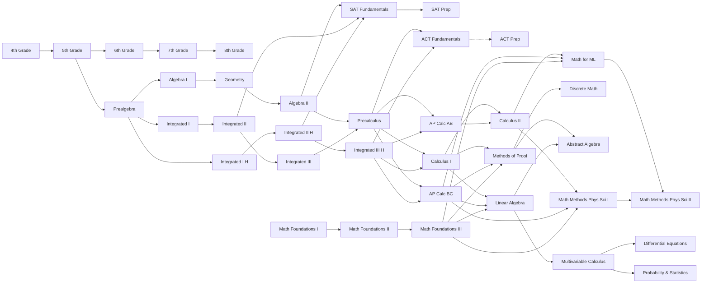

# 数学课程体系：Math Academy 课程目录

> 来源：<https://www.mathacademy.com/courses>，以及其链接的全部 37 个课程页 `/courses/<slug>`，抓取于 2026-10-30。
> 英文版：[math-curriculum.md](math-curriculum.md)。
> 逐课程完整内容在 [math-courses/](math-courses/) 中，每门课一个文件，包括描述、概览、学习成果，以及 单元 → 模块 → 知识点 的完整列表。全部课程的机器可读数据在 [math-courses/math-academy-courses.json](math-courses/math-academy-courses.json)。逐课程文件保留官网英文原文，未翻译，以保证名称准确。
> 相关文档：[the-math-academy-way.zh-CN.md](the-math-academy-way.zh-CN.md)、[math-academy-website.zh-CN.md](math-academy-website.zh-CN.md)。

本文记录 Math Academy 完整的数学课程体系，作为 Great Academy 建设数学内容的参照。课程范围从四年级算术一直到本科高年级数学。

## 要点速览

- **37 门课程，分 8 组：**
  - 小学 2 门、初中 4 门；
  - 高中 3 条序列共 10 门；
  - 备考 4 门、AP 2 门；
  - 面向成人的 Mathematical Foundations 3 门；
  - 大学 12 门。

  其中 ACT Math Prep 和 Abstract Algebra 在目录页标注为 "Coming soon"。Abstract Algebra 的课程页已列出完整内容，并注明"建设中"。
- **全部课程合计 9,270 个知识点位置，但不同的知识点名称只有 3,535 个。** 课程是**同一张知识图谱上的不同视图**，不是彼此独立的内容。例如 "The Law of Total Probability" 出现在 9 门课里。
- **内容层级统一：** 课程 → 单元（如 "2. Matrices"，标注知识点数）→ 模块（如 "2.4. Gaussian Elimination"）→ 知识点（topic，如 "2.4.3. …"）。
- **课程规模：**
  - 一般课程 130–360 个知识点。
  - 一学年或一学期的标准课约 130–230 个；honors 或压缩型课程约 280–360 个。
  - 备考 Fundamentals 课程大得多（SAT 651、ACT 905），因为它汇集了考试可能涉及的全部内容。
- **各序列的内容几乎完全一致：**
  - 传统序列（Algebra I + Geometry + Algebra II）有 582 个不同知识点，整合序列（Integrated Math I–III）有 588 个，只差 6 个仅出现在整合序列中的统计知识点。
  - Honors 整合序列（I–III Honors）的 838 个知识点与 Algebra I + Geometry + Algebra II + Precalculus **完全相同**。
  - AP Calculus AB 是 AP Calculus BC 的严格子集。BC 约等于 Calculus I + II 去掉双曲函数等少数进阶内容，再加上图形计算器知识点。
  - Mathematical Foundations I–III 的 1,038 个知识点**没有一个是独有的**，全部来自 K-12 课程或大学微积分课程。
- **独有内容只集中在少数课程：** 四年级、离散数学、证明方法、抽象代数、概率统计，以及备考 Prep 课程（SAT/ACT Math Prep 用的是自己的仿真题型知识点）。其余课程都在复用共享知识点。

## 1. 目录页信息（/courses）

- 原文称所有课程都 "comprehensive and standards-based"，通常涵盖数百个知识点。
- 每门课都以自适应诊断开始，找出学生缺失的先修知识和已经掌握的内容。
- **认证：** 课程获 ACS WASC（美国西部院校协会学校认证委员会）完全认证。
- **UC a-g：** Math Academy, LLC 已列入加州大学的 Directory of Online Publishers。在家上学的学校可以通过 UC 课程管理门户添加这些课程，之后 Math Academy 即可出具成绩单，用于 UC a-g 学分。
- **起点：** 最低一门是 4th Grade Math，要求会 12 以内的乘法表，并能独立阅读。
- **Prealgebra 与 6–8 年级：** Prealgebra 以精简形式覆盖 6–8 年级课程的相同内容，适合学得快的学生。
- **高中序列：**
  - 传统序列与整合序列内容相同，只是引入顺序不同。
  - 传统序列的缺点是学完一年 Geometry 后常要重学 Algebra I 技能；目录页称间隔重复缓解了这个问题。
  - Honors 整合序列用三年学完四年内容，包含 Precalculus。
  - 普通整合序列止于 Algebra II 水平，之后衔接 Precalculus。
- **备考：** SAT/ACT Math Prep 不能直接报名，必须先完成对应的 Fundamentals 课程，再晋级进入。
- **AP：** AP Calculus BC 对应大学两学期的 Calculus I + II；AB 约覆盖其中 70%。
- **Mathematical Foundations：** 面向想学大学进阶课程、但基础不足的成人，号称 "the fastest and most efficient way to get up to speed"。
- **大学课程：** 以顶尖大学的学期课程为蓝本，很多地方还更进一步。

## 2. 课程地图与先修关系

说明：
- 目录页把 ACT Math Prep 的先修课写成 "SAT Math Fundamentals"，疑为笔误：该课程的描述文字说学生是从 ACT Math Fundamentals 晋级进来的。
- 目录页没有给 8th Grade 指定后续课程。Algebra I 的先修课是 Prealgebra，所以 Prealgebra 和 6–8 年级实际上是进入高中的两条可选路线。

## 3. 汇总表

| # | 课程 | 分组 | 先修课 | 单元 | 模块 | 知识点 |
|---|---|---|---|---|---|---|
| 1 | [4th Grade Math](math-courses/4th-grade-math.md) | 小学 | 熟练掌握 12 以内乘法表 | 7 | 22 | 140 |
| 2 | [5th Grade Math](math-courses/5th-grade-math.md) | 小学 | 4th Grade Math | 9 | 19 | 133 |
| 3 | [6th Grade Math](math-courses/6th-grade-math.md) | 初中 | 5th Grade Math | 8 | 28 | 157 |
| 4 | [7th Grade Math](math-courses/7th-grade-math.md) | 初中 | 6th Grade Math | 5 | 27 | 170 |
| 5 | [8th Grade Math](math-courses/8th-grade-math.md) | 初中 | 7th Grade Math | 9 | 27 | 132 |
| 6 | [Prealgebra](math-courses/prealgebra.md) | 初中 | 5th Grade Math | 7 | 30 | 210 |
| 7 | [Algebra I](math-courses/algebra-i.md) | 高中·传统序列 | Prealgebra | 12 | 28 | 225 |
| 8 | [Geometry](math-courses/geometry.md) | 高中·传统序列 | Algebra I | 6 | 19 | 179 |
| 9 | [Algebra II](math-courses/algebra-ii.md) | 高中·传统序列 | Geometry | 9 | 29 | 179 |
| 10 | [Precalculus](math-courses/precalculus.md) | 高中·传统/整合序列 | Algebra II 或 Integrated Math III | 12 | 43 | 296 |
| 11 | [Integrated Math I](math-courses/integrated-math-i.md) | 高中·整合序列 | Prealgebra | 9 | 24 | 199 |
| 12 | [Integrated Math II](math-courses/integrated-math-ii.md) | 高中·整合序列 | Integrated Math I | 6 | 23 | 213 |
| 13 | [Integrated Math III](math-courses/integrated-math-iii.md) | 高中·整合序列 | Integrated Math II | 8 | 28 | 176 |
| 14 | [Integrated Math I (Honors)](math-courses/integrated-math-i-honors.md) | 高中·整合序列（Honors） | Prealgebra | 11 | 29 | 226 |
| 15 | [Integrated Math II (Honors)](math-courses/integrated-math-ii-honors.md) | 高中·整合序列（Honors） | Integrated Math I (Honors) | 12 | 45 | 335 |
| 16 | [Integrated Math III (Honors)](math-courses/integrated-math-iii-honors.md) | 高中·整合序列（Honors） | Integrated Math II (Honors) | 15 | 42 | 278 |
| 17 | [SAT Math Fundamentals](math-courses/sat-math-fundamentals.md) | 备考 | Algebra II、Integrated Math II 或 Integrated Math II (Honors) | 17 | 68 | 651 |
| 18 | [SAT Math Prep](math-courses/sat-math-prep.md) | 备考 | SAT Math Fundamentals（仅限晋级进入） | 4 | 45 | 284 |
| 19 | [ACT Math Fundamentals](math-courses/act-math-fundamentals.md) | 备考 | Precalculus 或 Integrated Math III (Honors) | 7 | 98 | 905 |
| 20 | [ACT Math Prep](math-courses/act-math-prep.md) | 备考（标注 Coming soon） | 目录页写作 SAT Math Fundamentals；实际由 ACT Math Fundamentals 晋级 | 6 | 39 | 348 |
| 21 | [AP Calculus AB](math-courses/ap-calculus-ab.md) | AP | Precalculus 或 Integrated Math III (Honors) | 9 | 36 | 212 |
| 22 | [AP Calculus BC](math-courses/ap-calculus-bc.md) | AP | Precalculus 或 Integrated Math III (Honors) | 16 | 53 | 305 |
| 23 | [Mathematical Foundations I](math-courses/mathematical-foundations-i.md) | 数学基础（成人） | — | 13 | 45 | 357 |
| 24 | [Mathematical Foundations II](math-courses/mathematical-foundations-ii.md) | 数学基础（成人） | Mathematical Foundations I | 14 | 52 | 360 |
| 25 | [Mathematical Foundations III](math-courses/mathematical-foundations-iii.md) | 数学基础（成人） | Mathematical Foundations II | 15 | 53 | 323 |
| 26 | [Calculus I](math-courses/calculus-i.md) | 大学 | Precalculus 或 Integrated Math III (Honors) | 8 | 27 | 175 |
| 27 | [Calculus II](math-courses/calculus-ii.md) | 大学 | Calculus I 或 AP Calculus AB | 5 | 29 | 160 |
| 28 | [Linear Algebra](math-courses/linear-algebra.md) | 大学 | Calculus I、AP Calculus BC 或 Mathematical Foundations III | 8 | 31 | 181 |
| 29 | [Multivariable Calculus](math-courses/multivariable-calculus.md) | 大学 | Linear Algebra | 6 | 29 | 187 |
| 30 | [Methods of Proof](math-courses/methods-of-proof.md) | 大学 | Calculus I、AP Calculus BC 或 Mathematical Foundations III | 7 | 20 | 135 |
| 31 | [Differential Equations](math-courses/differential-equations.md) | 大学 | Multivariable Calculus | 7 | 26 | 159 |
| 32 | [Discrete Mathematics](math-courses/discrete-mathematics.md) | 大学 | Methods of Proof | 8 | 33 | 143 |
| 33 | [Probability & Statistics](math-courses/probability-and-statistics.md) | 大学 | Multivariable Calculus | 10 | 33 | 181 |
| 34 | [Mathematics for Machine Learning](math-courses/mathematics-for-machine-learning.md) | 大学 | Calculus II、AP Calculus BC 或 Mathematical Foundations III | 12 | 47 | 301 |
| 35 | [Mathematical Methods for the Physical Sciences I](math-courses/mathematical-methods-for-the-physical-sciences-i.md) | 大学 | Calculus II、AP Calculus BC 或 Mathematical Foundations III | 13 | 46 | 294 |
| 36 | [Mathematical Methods for the Physical Sciences II](math-courses/mathematical-methods-for-the-physical-sciences-ii.md) | 大学 | Mathematical Methods for the Physical Sciences I | 12 | 40 | 232 |
| 37 | [Abstract Algebra](math-courses/abstract-algebra.md) | 大学（标注 Coming soon） | Methods of Proof；Linear Algebra | 9 | 21 | 129 |

合计：37 门课程 · 351 个单元 · 1,334 个模块 · 9,270 个知识点位置 · 3,535 个不同知识点名称。

## 4. 结构与复用分析

以下数据来自对 37 个课程页知识点名称的比对。

**知识点的共享程度：**

| 出现在几门课中 | 1 | 2 | 3 | 4 | 5 | 6+ |
|---|---|---|---|---|---|---|
| 知识点数 | 1,434 | 577 | 493 | 396 | 286 | 349 |

**某门课的知识点还出现在哪些课里（包含度）：**

| 课程 | 其知识点也出现在 |
|---|---|
| 7th Grade Math | SAT Fundamentals 82%、ACT Fundamentals 66%、Prealgebra 61% |
| Prealgebra | SAT Fundamentals 91%、Math Foundations I 81%、ACT Fundamentals 80% |
| Algebra I | ACT Fundamentals 92%、SAT Fundamentals 85%、Integrated I (H) 73% |
| Algebra II | Math Foundations II 84%、Integrated II (H) 78% |
| Integrated III (H) | Precalculus 85% |
| AP Calculus AB | AP Calculus BC 100%、Calculus I 72% |
| Calculus I | AP Calculus BC 89% |
| Calculus II | AP Calculus BC 88% |
| Linear Algebra | Math Methods Phys Sci I 65%、Math for ML 64% |
| Multivariable Calculus | Math Methods Phys Sci I 48%、Math Methods Phys Sci II 48% |
| Differential Equations | Math Methods Phys Sci I 48%、Math Methods Phys Sci II 36% |
| Probability & Statistics | Math for ML 52% |
| Math Foundations III | Precalculus 51%、Integrated III (H) 47%、AP Calculus BC 44% |

**发现的集合关系：**
- Algebra I ∪ Geometry ∪ Algebra II（582 个）与 Integrated I ∪ II ∪ III（588 个）几乎相同。差别只有 6 个仅出现在整合序列中的统计知识点：Sampling、Variance and Standard Deviation、Sigma Notation、The Mean of a Data Set、Residuals and Residual Plots、Correlation vs. Causation。
- Integrated I–III (Honors) 与 Algebra I ∪ Geometry ∪ Algebra II ∪ Precalculus **完全相等**（838 个）。
- AP Calculus AB ⊂ AP Calculus BC。
- BC 中不属于 Calculus I ∪ II 的 9 个知识点全部是图形计算器或技术类知识点，对应 AP 考试中可用计算器的部分。
- Calculus I ∪ II 有 39 个知识点不在 BC 中，例如：
  - 双曲函数及其导数、积分；
  - 对数求导法；
  - 牛顿法；
  - 旋转曲面面积；
  - 绕 x 轴的柱壳法；
  - 根值判别法；
  - 牛顿第二定律。
- Mathematical Foundations I ∪ II ∪ III（1,038 个）全部取自 K-12 课程和微积分课程，独有知识点为 0。
- Math Methods for the Physical Sciences I ∪ II 取自 Linear Algebra、Multivariable Calculus、Differential Equations、Probability & Statistics 和 Math for ML，只有 1 个例外。
- Prealgebra 只有 8 个知识点不在 5–8 年级课程中。6–8 年级课程反过来有 218 个知识点既不在 Prealgebra 也不在 Algebra I 中。可见年级课程覆盖更广、更贴合 CCSS 领域划分（如 "Ratios & Proportional Relationships"、"The Number System"、"Expressions & Equations"），Prealgebra 则是精简核心。
- **备考课程：**
  - SAT Math Fundamentals（651）和 ACT Math Fundamentals（905）主要汇集学校课程的知识点；SAT Fundamentals 有 89% 也在 ACT Fundamentals 中。
  - SAT Math Prep（284）和 ACT Math Prep（348）几乎全是独有知识点，即"高仿真 SAT 题型"。
  - SAT Math Prep 会把卡住的学生引回对应的 Fundamentals 知识点重新讲解。
  - 该课程没有固定终点，持续更新预估 SAT 分数。

**结论：** Math Academy 维护的是一张约 3,500 个知识点的知识图谱。"课程"是从中挑选并排序的一个知识点子集，再按单元、模块分组展示。这与书中的描述一致：课程是共享图谱上的一组知识点，诊断和任务选择都在图谱上运行，而不是在课程上。

## 5. 各课程详情

下面列出每门课的单元及其知识点数（单元名保留英文原文）。完整的模块和知识点列表见各课程链接的文件。

### 小学

#### 4th Grade Math

学习多位数的加减乘除；认识分数、小数等不同类型的数；学习几何中的线与角。

- **先修：** 熟练掌握 12 以内乘法表
- **规模：** 7 个单元 · 22 个模块 · 140 个知识点
- **完整内容：** [math-courses/4th-grade-math.md](math-courses/4th-grade-math.md) · [官网](https://www.mathacademy.com/courses/4th-grade-math)
- **单元：** 1. Operations & Algebraic Thinking (9); 2. The Number System (15); 3. Addition & Subtraction (13); 4. Multiplication (20); 5. Division (16); 6. Fractions & Decimals (45); 7. Measurement & Data (22)

#### 5th Grade Math

学习负数、分数和小数的运算；解决涉及测量、数据和几何的实际问题。

- **先修：** 4th Grade Math
- **规模：** 9 个单元 · 19 个模块 · 133 个知识点
- **完整内容：** [math-courses/5th-grade-math.md](math-courses/5th-grade-math.md) · [官网](https://www.mathacademy.com/courses/5th-grade-math)
- **单元：** 1. The Number System (9); 2. Multiplying & Dividing Whole Numbers (18); 3. Adding & Subtracting Fractions (14); 4. Multiplying & Dividing Fractions (26); 5. Decimals (18); 6. Multiplying & Dividing Decimals (17); 7. Exponents (10); 8. Measurement & Data (12); 9. Geometry (9)

### 初中

#### 6th Grade Math

学习比与比率、百分数、多位数除法、分数除法、小数、有理数、表达式、方程、几何与统计。

- **先修：** 5th Grade Math
- **规模：** 8 个单元 · 28 个模块 · 157 个知识点
- **完整内容：** [math-courses/6th-grade-math.md](math-courses/6th-grade-math.md) · [官网](https://www.mathacademy.com/courses/6th-grade-math)
- **单元：** 1. Ratios & Proportional Relationships (28); 2. The Number System: Whole Number Division (11); 3. The Number System: Dividing Fractions (17); 4. The Number System: Decimals (16); 5. The Number System: Rational Numbers (20); 6. Expressions & Equations (27); 7. Geometry (20); 8. Statistics & Probability (18)

#### 7th Grade Math

学习比例关系、百分数、有理数、表达式、方程、几何、统计与概率，并应用于比例尺、理财、测量和数据等实际问题。

- **先修：** 6th Grade Math
- **规模：** 5 个单元 · 27 个模块 · 170 个知识点
- **完整内容：** [math-courses/7th-grade-math.md](math-courses/7th-grade-math.md) · [官网](https://www.mathacademy.com/courses/7th-grade-math)
- **单元：** 1. Ratios & Proportional Relationships (22); 2. The Number System (28); 3. Expressions & Equations (45); 4. Geometry (45); 5. Statistics & Probability (30)

#### 8th Grade Math

学习指数、根式、科学记数法、方程、图像、函数、几何、变换、勾股定理和统计；解决涉及测量、单位和数据的实际问题。

- **先修：** 7th Grade Math
- **规模：** 9 个单元 · 27 个模块 · 132 个知识点
- **完整内容：** [math-courses/8th-grade-math.md](math-courses/8th-grade-math.md) · [官网](https://www.mathacademy.com/courses/8th-grade-math)
- **单元：** 1. The Real Number System (6); 2. Exponents & Scientific Notation (22); 3. Radicals (16); 4. Number Theory (8); 5. Linear Equations (21); 6. Functions (10); 7. Geometry: Transformations, Congruence, & Similarity (29); 8. The Pythagorean Theorem & Volume (11); 9. Statistics: Bivariate Data (9)

#### Prealgebra

衔接小学算术与初中代数、几何：深化算术和几何理解，学习变量，求解线性方程、不等式和方程组。以更精简的形式覆盖 6–8 年级内容，适合学得快的学生。

- **先修：** 5th Grade Math
- **规模：** 7 个单元 · 30 个模块 · 210 个知识点
- **完整内容：** [math-courses/prealgebra.md](math-courses/prealgebra.md) · [官网](https://www.mathacademy.com/courses/prealgebra)
- **单元：** 1. Ratios & Percentages (30); 2. The Number System (29); 3. Exponents & Radicals (35); 4. Algebraic Expressions (17); 5. Equations & Inequalities (29); 6. Geometry (48); 7. Statistics (22)

### 高中

#### Algebra I

提升代数技能，学习函数与作图，深入学习二次函数与二次方程。

- **先修：** Prealgebra
- **规模：** 12 个单元 · 28 个模块 · 225 个知识点
- **完整内容：** [math-courses/algebra-i.md](math-courses/algebra-i.md) · [官网](https://www.mathacademy.com/courses/algebra-i)
- **单元：** 1. Equations & Inequalities (25); 2. Two-Variable Equations & Inequalities (33); 3. Units (13); 4. Radical Expressions (12); 5. Rational Expressions & Equations (7); 6. Functions (18); 7. Absolute Value (14); 8. Exponential Functions (22); 9. Polynomials (20); 10. Quadratic Equations & Functions (37); 11. Sequences (18); 12. Bivariate Statistics (6)

#### Geometry

学习计算各种图形的长度、面积和体积；探索直角三角形中角与边的关系。

- **先修：** Algebra I
- **规模：** 6 个单元 · 19 个模块 · 179 个知识点
- **完整内容：** [math-courses/geometry.md](math-courses/geometry.md) · [官网](https://www.mathacademy.com/courses/geometry)
- **单元：** 1. Proof, Congruence, & Similarity (42); 2. Circles & Radian Measure (28); 3. Geometry in the Coordinate Plane (22); 4. Triangles, Quadrilaterals, & Trigonometry (27); 5. Solid Geometry (26); 6. Probability & Combinatorics (34)

#### Algebra II

掌握进阶函数的代数，包括二次函数、对数、三角函数等；深入学习多项式理论。

- **先修：** Geometry
- **规模：** 9 个单元 · 29 个模块 · 179 个知识点
- **完整内容：** [math-courses/algebra-ii.md](math-courses/algebra-ii.md) · [官网](https://www.mathacademy.com/courses/algebra-ii)
- **单元：** 1. Number Systems (10); 2. Polynomials (30); 3. Functions (26); 4. Exponentials & Logarithms (35); 5. Rational Expressions & Functions (12); 6. Radical Expressions & Functions (11); 7. Conic Sections (9); 8. The Unit Circle (21); 9. Trigonometric Functions (25)

#### Precalculus

学习进阶三角学和概率统计的核心概念；接触复数、向量、矩阵等高等数学对象。

- **先修：** Algebra II 或 Integrated Math III
- **规模：** 12 个单元 · 43 个模块 · 296 个知识点
- **完整内容：** [math-courses/precalculus.md](math-courses/precalculus.md) · [官网](https://www.mathacademy.com/courses/precalculus)
- **单元：** 1. Sequences and Series (18); 2. Rational Functions (16); 3. Inequalities (21); 4. Trigonometry (42); 5. Vectors (30); 6. Matrices (37); 7. Conic Sections (20); 8. Parametric Equations (10); 9. Polar Equations (6); 10. Complex Numbers (28); 11. Probability & Combinatorics (48); 12. Statistics (20)

#### Integrated Math I

提升代数技能，学习函数与作图，解决几何和实际建模问题。

- **先修：** Prealgebra
- **规模：** 9 个单元 · 24 个模块 · 199 个知识点
- **完整内容：** [math-courses/integrated-math-i.md](math-courses/integrated-math-i.md) · [官网](https://www.mathacademy.com/courses/integrated-math-i)
- **单元：** 1. Equations & Inequalities (25); 2. Two-Variable Equations & Inequalities (32); 3. Units (13); 4. Rationals & Radicals (17); 5. Functions (14); 6. Absolute Value (14); 7. Exponents (21); 8. Polynomials (20); 9. Geometry (43)

#### Integrated Math II

掌握二次式的代数，初步接触多项式、对数、三角等进阶函数；学习概率的核心概念。

- **先修：** Integrated Math I
- **规模：** 6 个单元 · 23 个模块 · 213 个知识点
- **完整内容：** [math-courses/integrated-math-ii.md](math-courses/integrated-math-ii.md) · [官网](https://www.mathacademy.com/courses/integrated-math-ii)
- **单元：** 1. Quadratics (38); 2. Functions & Sequences (32); 3. Exponentials & Logarithms (17); 4. Geometry (70); 5. Trigonometry (32); 6. Probability & Statistics (24)

#### Integrated Math III

深入学习多项式的代数，练习三角函数作图，掌握根式函数和对数的代数；学习组合、概率与统计的核心概念。

- **先修：** Integrated Math II
- **规模：** 8 个单元 · 28 个模块 · 176 个知识点
- **完整内容：** [math-courses/integrated-math-iii.md](math-courses/integrated-math-iii.md) · [官网](https://www.mathacademy.com/courses/integrated-math-iii)
- **单元：** 1. Polynomials (30); 2. Rationals and Radicals (25); 3. Exponentials & Logarithms (18); 4. Number Systems (10); 5. Sequences (15); 6. Geometry (25); 7. Trigonometry (31); 8. Probability & Statistics (22)

#### Integrated Math I (Honors)

提升代数技能，学习函数与作图，解决几何和实际建模问题（Honors 序列：三年学完四年内容）。

- **先修：** Prealgebra
- **规模：** 11 个单元 · 29 个模块 · 226 个知识点
- **完整内容：** [math-courses/integrated-math-i-honors.md](math-courses/integrated-math-i-honors.md) · [官网](https://www.mathacademy.com/courses/integrated-math-i-honors)
- **单元：** 1. Equations & Inequalities (25); 2. Two-Variable Equations & Inequalities (32); 3. Units (13); 4. Radicals and Rationals (17); 5. Functions (14); 6. Absolute Value (6); 7. Exponents (21); 8. Polynomials (20); 9. Sequences (12); 10. Geometry (60); 11. Statistics (6)

#### Integrated Math II (Honors)

掌握二次式、多项式、对数、三角等进阶函数的代数；学习组合、概率与统计的核心概念。

- **先修：** Integrated Math I (Honors)
- **规模：** 12 个单元 · 45 个模块 · 335 个知识点
- **完整内容：** [math-courses/integrated-math-ii-honors.md](math-courses/integrated-math-ii-honors.md) · [官网](https://www.mathacademy.com/courses/integrated-math-ii-honors)
- **单元：** 1. Number Systems (10); 2. Polynomials (31); 3. Quadratic Functions (18); 4. Functions (30); 5. Absolute Value Functions (8); 6. Exponentials & Logarithms (35); 7. Sequences & Series (17); 8. Rationals & Radicals (7); 9. Geometry (53); 10. Solid Geometry (26); 11. Trigonometry (57); 12. Probability & Statistics (43)

#### Integrated Math III (Honors)

深入学习多项式、根式与有理函数以及进阶三角学；接触复数、向量、矩阵、参数方程和极坐标方程。

- **先修：** Integrated Math II (Honors)
- **规模：** 15 个单元 · 42 个模块 · 278 个知识点
- **完整内容：** [math-courses/integrated-math-iii-honors.md](math-courses/integrated-math-iii-honors.md) · [官网](https://www.mathacademy.com/courses/integrated-math-iii-honors)
- **单元：** 1. Sequences & Series (7); 2. Polynomials (19); 3. Rational Equations & Functions (21); 4. Radical Functions (13); 5. Inequalities (21); 6. Conics (20); 7. Trigonometric Functions (10); 8. Trigonometric Identities (22); 9. Trigonometric Equations (15); 10. Parametric Equations (10); 11. Polar Equations (6); 12. Complex Numbers (28); 13. Vectors (30); 14. Matrices (37); 15. Probability and Statistics (19)

### 备考

#### SAT Math Fundamentals

覆盖 SAT 规定的全部知识点：基础与进阶代数、平面与立体几何、三角、函数、统计、概率和问题求解。

- **先修：** Algebra II、Integrated Math II 或 Integrated Math II (Honors)
- **规模：** 17 个单元 · 68 个模块 · 651 个知识点
- **完整内容：** [math-courses/sat-math-fundamentals.md](math-courses/sat-math-fundamentals.md) · [官网](https://www.mathacademy.com/courses/sat-math-fundamentals)
- **单元：** 1. Preliminaries (68); 2. Algebra - Linear Equations in One Variable (26); 3. Algebra - Linear Equations in Two Variables (39); 4. Algebra - Linear Inequalities (25); 5. Geometry - Points, Lines, & Angles (32); 6. Geometry - Polygons & Solids (27); 7. Geometry - Congruence & Similarity (24); 8. Geometry - Length, Area & Volume (35); 9. Geometry - Circles (24); 10. Trigonometry (31); 11. Advanced Algebra - Functions (32); 12. Advanced Algebra - Absolute Value (11); 13. Advanced Algebra - Polynomials (93); 14. Advanced Algebra - Exponential Equations & Functions (33); 15. Advanced Algebra - Rational and Radical Equations (31); 16. Problem Solving - Ratios & Percentages (49); 17. Data Analysis - Statistics & Probability (71)

#### SAT Math Prep

SAT Math Fundamentals 的后续课程，纯练习型，只做高仿真 SAT 题型，追求最高分；不能直接报名，须完成 Fundamentals 后晋级。没有固定终点，持续给出预估分数。

- **先修：** SAT Math Fundamentals（仅限晋级进入）
- **规模：** 4 个单元 · 45 个模块 · 284 个知识点
- **完整内容：** [math-courses/sat-math-prep.md](math-courses/sat-math-prep.md) · [官网](https://www.mathacademy.com/courses/sat-math-prep)
- **单元：** 1. Algebra (77); 2. Advanced Math (80); 3. Geometry and Trigonometry (60); 4. Problem-Solving and Data Analysis (67)

#### ACT Math Fundamentals

掌握 ACT 重要知识点，包括实数与复数、整数与有理指数、向量与矩阵、各类函数关系、几何、统计和概率。

- **先修：** Precalculus 或 Integrated Math III (Honors)
- **规模：** 7 个单元 · 98 个模块 · 905 个知识点
- **完整内容：** [math-courses/act-math-fundamentals.md](math-courses/act-math-fundamentals.md) · [官网](https://www.mathacademy.com/courses/act-math-fundamentals)
- **单元：** 1. Number & Quantity (90); 2. Algebra (223); 3. Functions (201); 4. Geometry (206); 5. Statistics & Probability (100); 6. Integrating Essential Skills (62); 7. Modeling (23)

#### ACT Math Prep

ACT Math Fundamentals 的后续课程，帮助学生在 ACT 数学部分取得最高分；不能直接报名，须完成 Fundamentals 后晋级。目录页标注 "Coming soon"，但课程页已列出内容。

- **先修：** 目录页写作 SAT Math Fundamentals；实际由 ACT Math Fundamentals 晋级
- **规模：** 6 个单元 · 39 个模块 · 348 个知识点
- **完整内容：** [math-courses/act-math-prep.md](math-courses/act-math-prep.md) · [官网](https://www.mathacademy.com/courses/act-math-prep)
- **单元：** 1. Number & Quantity (34); 2. Algebra (63); 3. Functions (52); 4. Geometry (88); 5. Statistics & Probability (44); 6. Integrating Essential Skills (67)

### AP

#### AP Calculus AB

学习极限、连续、导数、不定积分与定积分，并在多种情境中应用。约覆盖 BC 的 70%。

- **先修：** Precalculus 或 Integrated Math III (Honors)
- **规模：** 9 个单元 · 36 个模块 · 212 个知识点
- **完整内容：** [math-courses/ap-calculus-ab.md](math-courses/ap-calculus-ab.md) · [官网](https://www.mathacademy.com/courses/ap-calculus-ab)
- **单元：** 1. Limits and Continuity (43); 2. Differentiation: Definition and Fundamental Properties (19); 3. Differentiation: Composite, Implicit, and Inverse Functions (13); 4. Contextual Applications of Differentiation (17); 5. Analytical Applications of Differentiation (29); 6. Integration (48); 7. Differential Equations (18); 8. Applications of Integration (18); 9. Applications of Technology (7)

#### AP Calculus BC

掌握单变量微积分基础，包括向量、参数方程和极坐标方程；学习无穷级数的敛散性判别，并用泰勒级数逼近函数。对应大学 Calculus I + II。

- **先修：** Precalculus 或 Integrated Math III (Honors)
- **规模：** 16 个单元 · 53 个模块 · 305 个知识点
- **完整内容：** [math-courses/ap-calculus-bc.md](math-courses/ap-calculus-bc.md) · [官网](https://www.mathacademy.com/courses/ap-calculus-bc)
- **单元：** 1. Limits (32); 2. Continuity (13); 3. Introduction to Differentiation (19); 4. Advanced Differentiation (14); 5. Contextual Applications of Differentiation (16); 6. Analytical Applications of Differentiation (27); 7. Integration (33); 8. Techniques of Integration (32); 9. Differential Equations (23); 10. Applications of Integration (13); 11. Parametric Equations (7); 12. Polar Equations (10); 13. Particle Dynamics (13); 14. Sequences & Series (30); 15. Power Series (14); 16. Applications of Technology (9)

### 数学基础（成人）

#### Mathematical Foundations I

巩固算术，学习变量与图像，提升代数，掌握几何要点。

- **先修：** —
- **规模：** 13 个单元 · 45 个模块 · 357 个知识点
- **完整内容：** [math-courses/mathematical-foundations-i.md](math-courses/mathematical-foundations-i.md) · [官网](https://www.mathacademy.com/courses/mathematical-foundations-i)
- **单元：** 1. Fractions (41); 2. Ratios & Percentages (47); 3. The Number System (31); 4. Exponents & Radicals (32); 5. Equations & Inequalities (50); 6. Two-Variable Equations (29); 7. Radical & Rational Expressions (17); 8. Functions (13); 9. Absolute Value (11); 10. Exponential Functions (18); 11. Polynomials (20); 12. Geometry Fundamentals (27); 13. Polygons (21)

#### Mathematical Foundations II

掌握二次、对数、三角等进阶函数的代数；深入学习多项式；学习微积分中极限、导数、积分的基础；接触复数、向量、概率与统计。

- **先修：** Mathematical Foundations I
- **规模：** 14 个单元 · 52 个模块 · 360 个知识点
- **完整内容：** [math-courses/mathematical-foundations-ii.md](math-courses/mathematical-foundations-ii.md) · [官网](https://www.mathacademy.com/courses/mathematical-foundations-ii)
- **单元：** 1. Quadratics (32); 2. Polynomials (28); 3. Number Systems (12); 4. Functions (26); 5. Exponentials & Logarithms (30); 6. Radical & Rational Functions (29); 7. Sequences (18); 8. Geometry (35); 9. Trigonometry (52); 10. Vectors (11); 11. Limits & Continuity (22); 12. Introduction to Calculus (30); 13. Statistics (14); 14. Probability & Combinatorics (21)

#### Mathematical Foundations III

学习计算极限、导数、积分的进阶技巧，将微积分用于相关变化率、最优化、质点运动和微分方程；深入学习复数、向量、矩阵、参数与极坐标曲线、概率与统计。

- **先修：** Mathematical Foundations II
- **规模：** 15 个单元 · 53 个模块 · 323 个知识点
- **完整内容：** [math-courses/mathematical-foundations-iii.md](math-courses/mathematical-foundations-iii.md) · [官网](https://www.mathacademy.com/courses/mathematical-foundations-iii)
- **单元：** 1. Sequences and Series (22); 2. Inequalities (20); 3. Parametric & Polar Coordinates (15); 4. Conic Sections (27); 5. Trigonometry (26); 6. Complex Numbers (16); 7. Limits & Continuity (11); 8. Differentiation (32); 9. Definite Integrals (20); 10. Integration Techniques (30); 11. Contextual Applications of Calculus (21); 12. Differential Equations (9); 13. Vectors (17); 14. Linear Algebra (37); 15. Probability (20)

### 大学

#### Calculus I

学习支撑科学和工程的"变化的数学"：掌握极限、导数和积分基础。

- **先修：** Precalculus 或 Integrated Math III (Honors)
- **规模：** 8 个单元 · 27 个模块 · 175 个知识点
- **完整内容：** [math-courses/calculus-i.md](math-courses/calculus-i.md) · [官网](https://www.mathacademy.com/courses/calculus-i)
- **单元：** 1. Preliminaries (6); 2. Limits (33); 3. Continuity (13); 4. Introduction to Differentiation (22); 5. Advanced Differentiation (18); 6. Contextual Applications of Differentiation (16); 7. Analytical Applications of Differentiation (33); 8. Integration (34)

#### Calculus II

深化微积分：掌握进阶积分技巧，用微分方程为实际情境建模等。

- **先修：** Calculus I 或 AP Calculus AB
- **规模：** 5 个单元 · 29 个模块 · 160 个知识点
- **完整内容：** [math-courses/calculus-ii.md](math-courses/calculus-ii.md) · [官网](https://www.mathacademy.com/courses/calculus-ii)
- **单元：** 1. Integration Techniques (41); 2. Applications of Integration (27); 3. Parametric & Polar Equations (23); 4. Sequences & Series (46); 5. Differential Equations (23)

#### Linear Algebra

深入学习向量与矩阵背后的数学：大量计算方法和概念联系，最终统一成优雅的整体。

- **先修：** Calculus I、AP Calculus BC 或 Mathematical Foundations III
- **规模：** 8 个单元 · 31 个模块 · 181 个知识点
- **完整内容：** [math-courses/linear-algebra.md](math-courses/linear-algebra.md) · [官网](https://www.mathacademy.com/courses/linear-algebra)
- **单元：** 1. Preliminaries (25); 2. Matrices (36); 3. Vector Spaces (27); 4. Linear Transformations (10); 5. Diagonalization of Matrices (29); 6. Projections (25); 7. Quadratic Forms (20); 8. Applications of Linear Algebra (9)

#### Multivariable Calculus

把微积分推广到向量值函数和多元函数。

- **先修：** Linear Algebra
- **规模：** 6 个单元 · 29 个模块 · 187 个知识点
- **完整内容：** [math-courses/multivariable-calculus.md](math-courses/multivariable-calculus.md) · [官网](https://www.mathacademy.com/courses/multivariable-calculus)
- **单元：** 1. Vector Functions and Vector Fields (27); 2. Multivariable Functions (53); 3. Multiple Integrals (36); 4. Line Integrals (30); 5. Surface Integrals (20); 6. Applications of Multivariable Calculus (21)

#### Methods of Proof

熟练掌握集合与逻辑这一数学中最基础的结构与运算；理解什么是证明，掌握多种证明技巧。

- **先修：** Calculus I、AP Calculus BC 或 Mathematical Foundations III
- **规模：** 7 个单元 · 20 个模块 · 135 个知识点
- **完整内容：** [math-courses/methods-of-proof.md](math-courses/methods-of-proof.md) · [官网](https://www.mathacademy.com/courses/methods-of-proof)
- **单元：** 1. Logic (31); 2. Set Theory (27); 3. Mathematical Proof (15); 4. Discrete Mathematics & Number Theory (13); 5. Sequences & Functions (20); 6. Congruence of Integers (14); 7. Equivalence Relations (15)

#### Differential Equations

掌握求解用微积分为实际情境建模时出现的各类方程的技巧。

- **先修：** Multivariable Calculus
- **规模：** 7 个单元 · 26 个模块 · 159 个知识点
- **完整内容：** [math-courses/differential-equations.md](math-courses/differential-equations.md) · [官网](https://www.mathacademy.com/courses/differential-equations)
- **单元：** 1. First-Order Differential Equations (28); 2. Modeling With First-Order Differential Equations (21); 3. Linear Differential Equations (29); 4. Systems of Differential Equations (27); 5. Laplace Transforms (18); 6. Boundary Value Problems (14); 7. Approximating Solutions to Differential Equations (22)

#### Discrete Mathematics

学习处理离散量（而非连续量）的数学方法；接触在计算机科学中广泛应用的图论、算法等领域。

- **先修：** Methods of Proof
- **规模：** 8 个单元 · 33 个模块 · 143 个知识点
- **完整内容：** [math-courses/discrete-mathematics.md](math-courses/discrete-mathematics.md) · [官网](https://www.mathacademy.com/courses/discrete-mathematics)
- **单元：** 1. Preliminaries (4); 2. Boolean Algebra (17); 3. Number Theory (15); 4. Probability & Combinatorics (39); 5. Sequences (14); 6. Recursion (14); 7. Graph Theory (27); 8. The Theory of Algorithms (13)

#### Probability & Statistics

学习"机会的数学"，对不确定事件的可能结果作出精确推断；用严谨方法分析真实数据。

- **先修：** Multivariable Calculus
- **规模：** 10 个单元 · 33 个模块 · 181 个知识点
- **完整内容：** [math-courses/probability-and-statistics.md](math-courses/probability-and-statistics.md) · [官网](https://www.mathacademy.com/courses/probability-and-statistics)
- **单元：** 1. Probability & Random Variables (20); 2. Expectation (16); 3. Discrete Probability Distributions (20); 4. Continuous Probability Distributions (21); 5. Combining Random Variables (31); 6. Parametric Inference (21); 7. Confidence Intervals (15); 8. Hypothesis Testing (19); 9. Regression (11); 10. Nonparametric Inference (7)

#### Mathematics for Machine Learning

学习理解和实现核心机器学习算法所需的线性代数、多元微积分和概率统计知识，为大学 ML 课程（梯度下降、神经网络与反向传播、SVM、逻辑回归/lasso、朴素贝叶斯、PCA、矩阵分解、高斯混合模型等）做准备。

- **先修：** Calculus II、AP Calculus BC 或 Mathematical Foundations III
- **规模：** 12 个单元 · 47 个模块 · 301 个知识点
- **完整内容：** [math-courses/mathematics-for-machine-learning.md](math-courses/mathematics-for-machine-learning.md) · [官网](https://www.mathacademy.com/courses/mathematics-for-machine-learning)
- **单元：** 1. Set Theory (25); 2. Logic (19); 3. Vectors and Matrices (35); 4. Vector Spaces (21); 5. Diagonalization of Matrices (13); 6. Orthogonality & Projections (18); 7. Singular Value Decomposition (12); 8. Applications of Linear Algebra (9); 9. Multivariable Calculus (57); 10. Probability & Random Variables (41); 11. Combining Random Variables (29); 12. Parametric Inference (22)

#### Mathematical Methods for the Physical Sciences I

建立理论与应用物理中通用的核心数学结构和分析工具：在微积分和线性代数入门的基础上，以统一框架讲授向量几何、多元分析和微分方程，用于物理系统建模。

- **先修：** Calculus II、AP Calculus BC 或 Mathematical Foundations III
- **规模：** 13 个单元 · 46 个模块 · 294 个知识点
- **完整内容：** [math-courses/mathematical-methods-for-the-physical-sciences-i.md](math-courses/mathematical-methods-for-the-physical-sciences-i.md) · [官网](https://www.mathacademy.com/courses/mathematical-methods-for-the-physical-sciences-i)
- **单元：** 1. Preliminaries (25); 2. Matrices (34); 3. Vector Spaces (27); 4. Linear Transformations (10); 5. Diagonalization of Matrices (20); 6. Multivariable Functions (45); 7. Vector Functions and Vector Fields (26); 8. Multiple Integrals (12); 9. Probability & Random Variables (28); 10. Continuous Probability Distributions (10); 11. First-Order Differential Equations (12); 12. Modeling With First-Order Differential Equations (21); 13. Linear Differential Equations (24)

#### Mathematical Methods for the Physical Sciences II

继续学习现代物理中的进阶数学技巧：正交性、多重积分、向量微积分定理，以及微分方程的进阶解法。

- **先修：** Mathematical Methods for the Physical Sciences I
- **规模：** 12 个单元 · 40 个模块 · 232 个知识点
- **完整内容：** [math-courses/mathematical-methods-for-the-physical-sciences-ii.md](math-courses/mathematical-methods-for-the-physical-sciences-ii.md) · [官网](https://www.mathacademy.com/courses/mathematical-methods-for-the-physical-sciences-ii)
- **单元：** 1. Projections (25); 2. Quadratic Forms (15); 3. Applications of Linear Algebra (4); 4. Multiple Integrals (17); 5. Line Integrals (29); 6. Surface Integrals (20); 7. Applications of Multivariable Calculus (22); 8. Systems of Differential Equations (27); 9. Laplace Transforms (18); 10. Boundary Value Problems (14); 11. Approximating Solutions to Differential Equations (16); 12. Combining Random Variables (25)

#### Abstract Algebra

深入研究数学对象之间相互作用的核心关系；学会识别代数结构，并通过数学推理得出一般结论。课程页注明"建设中，上线日期未定"。

- **先修：** Methods of Proof；Linear Algebra
- **规模：** 9 个单元 · 21 个模块 · 129 个知识点
- **完整内容：** [math-courses/abstract-algebra.md](math-courses/abstract-algebra.md) · [官网](https://www.mathacademy.com/courses/abstract-algebra)
- **单元：** 1. Preliminaries (3); 2. Groups (30); 3. Permutations (15); 4. Product and Quotient Groups (19); 5. Homomorphisms & Isomorphisms (7); 6. Group Actions (13); 7. Group Structures (4); 8. Rings & Fields (30); 9. Vector Spaces (8)

## 6. 对 Great Academy 的启示

1. **先建一张图谱，再从中切出课程。** 覆盖四年级到本科高年级，目标约 3,500 个不同知识点。课程归属、单元/模块分组和显示顺序作为图谱之上的元数据存储，不要做成彼此独立的内容。
2. **粒度参考：** 每个模块约 7 个知识点，每个单元约 4 个模块，每门课 130–360 个知识点。[math-courses/](math-courses/) 中的知识点名称就是现成的粒度基准：每个对应一个可教的概念，约 10–20 分钟一节课。
3. **不同序列是重新排序，不是重写。** 传统与整合序列、honors 压缩序列都能由同一知识点池生成；成人 Foundations 课程也可以从已有知识点中交叉选取。
4. **备考分两层：** Fundamentals 层复用课程知识点；Prep 层是独立的考试题型知识点，并链接回 Fundamentals 知识点用于补救。
5. **建议的建设优先级（待定）：**
   - 先做一条连续主干，例如 Prealgebra → Algebra I → Geometry → Algebra II → Precalculus → Calculus I/II，共 1,378 个不同知识点。
   - 之后其余大部分 K-12、Foundations 和备考 Fundamentals 课程基本只是重新分组。
   - 独有内容的课程（4–5 年级、Methods of Proof、Discrete Math、Probability & Statistics、Abstract Algebra）可以放在后面。
6. **官网页面没有提供的东西：**
   - 知识点之间的先修边和包含边；
   - 知识点内部的 knowledge point、例题和习题；
   - XP 值；
   - 知识点在图谱中的真实先后关系（编号只是展示顺序）。
   这些都需要自己编写。不过官网的顺序和名称已经是一个很好的起始骨架。
